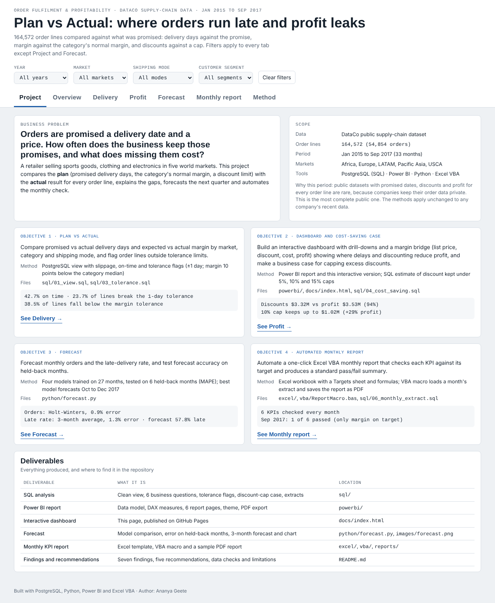
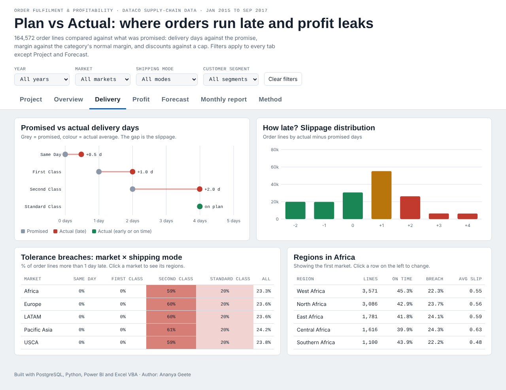
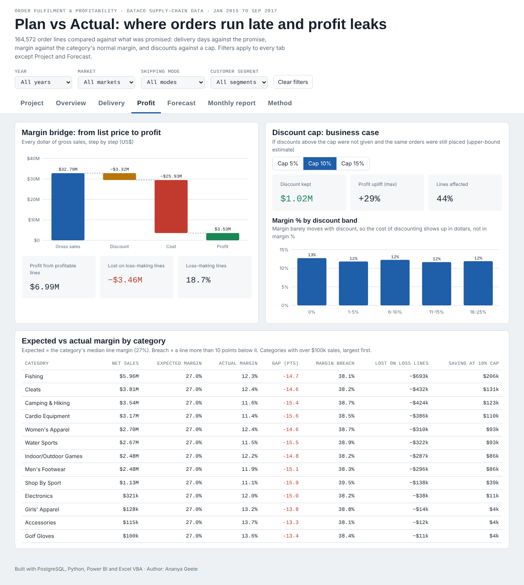
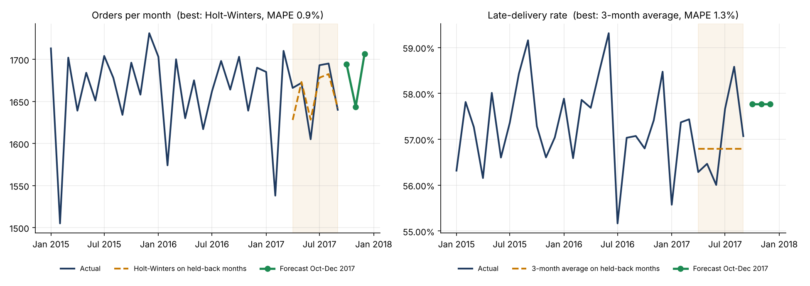
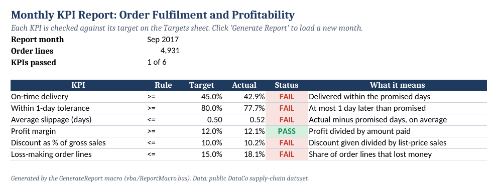

# Order Fulfilment and Profitability Analysis: Plan vs Actual

**Where does a business lose time and money?** This project compares what was promised with what actually happened across **164,572 order lines** (54,854 orders, Jan 2015 to Sep 2017). It checks delivery days against the promise, margin against the category's normal margin and discounts against a cap. It also forecasts the next quarter and automates a monthly pass/fail KPI report in Excel.

**[Open the interactive dashboard](https://ananyageete.github.io/order-fulfilment-plan-vs-actual/)**



**Tools:** SQL (PostgreSQL) · Power BI · Python (pandas, NumPy, Matplotlib) · Excel (VBA)

---

## Objectives and deliverables
| # | Objective | Deliverable | Result |
|---|---|---|---|
| 1 | Compare promised vs actual delivery days and expected vs actual margin by market, category and shipping mode, and flag order lines outside tolerance limits | `sql/01_view.sql`, `sql/03_tolerance.sql` · dashboard **Delivery** tab | 42.7% on time; 23.7% of lines more than 1 day late; 38.5% below the margin tolerance |
| 2 | Build an interactive dashboard with drill-downs and a margin bridge, and make a cost-saving case for capping excess discounts | Power BI report (`powerbi/`), interactive dashboard (`docs/`), `sql/04_cost_saving.sql` · **Profit** tab | Discounts $3.32M vs profit $3.53M; a 10% cap keeps up to $1.02M (+29% profit) |
| 3 | Forecast monthly orders and the late-delivery rate, and test accuracy on held-back months | `python/forecast.py` · **Forecast** tab | 0.9% error for orders, 1.3% for late rate; next quarter about 57.8% late |
| 4 | Automate a one-click monthly report that checks each KPI against its target with a pass/fail summary | `excel/`, `vba/ReportMacro.bas`, `reports/` · **Monthly report** tab | 6 KPIs checked every month; Sep 2017 passed 1 of 6 |

## Why data from 2015 to 2017?
Public datasets that have the **promised and actual delivery days, discount, cost and profit on every order line** are rare, because companies keep their order data private. Newer public datasets (for example the Brazilian Olist e-commerce data, 2016 to 2018) have delivery dates but no cost or profit, and retail sample datasets like Superstore have no delivery promise. DataCo is the most complete public dataset for a plan-vs-actual study. The SQL, Power BI model, forecast and Excel report work unchanged on any company's current data: only the input file changes.

## Business questions
1. How often are orders delivered later than promised, and by how many days?
2. Which markets and shipping modes miss the plan most?
3. Where is actual margin below the expected (normal) margin?
4. How much profit do discounts give away, and what would a discount cap save?
5. What will orders and the late-delivery rate look like next quarter?
6. Can the monthly KPI check be done in one click?

## Key findings
| # | Finding | Evidence |
|---|---|---|
| 1 | **Only 42.7% of order lines arrive within the promised days.** The rate stays between 42.2% and 43.2% in all five markets and across 33 months, so this is a process and promise problem, not a regional one. | `sql/02_kpis.sql` Q1, Q3 |
| 2 | **First Class is promised in 1 day but always takes 2** (0% on time, 100% within the 1-day tolerance). These lines are about 27% of all late lines. Promising 2 days would remove them without changing how anything ships. | Q2 |
| 3 | **Second Class is the real operational gap:** promised 2 days, averages 3.99. Only 20.2% arrive on time and about 60% are more than 1 day late, in every market. | Q2, `03_tolerance.sql` T2 |
| 4 | **Discounts of $3.32M almost equal the $3.53M profit (94%).** Margin % hardly changes by discount band (11.7% to 12.7%), so the cost of discounting shows up in dollars, not in the margin rate. | `04_cost_saving.sql` C1, Q4 |
| 5 | **A 10% discount cap would have kept up to $1.02M**, an upper bound of +29% profit, affecting 44% of lines. A 15% cap keeps $0.38M and touches 28% of lines. | C2 |
| 6 | **18.7% of order lines lose money, in every category.** They wipe out $3.46M of the $6.99M made on profitable lines. That is why actual margin (12.0%) sits far below the typical line margin (27%), and why 38.5% of lines fall more than 10 points below expected margin. | Q6, T1, T3 |
| 7 | **The next quarter will look the same without action:** forecast about 1,640 to 1,710 orders a month with a 57.8% late rate (forecast error under 1.5% on held-back months). | `python/forecast.py` |

## Recommendations
1. **Reset the First Class promise to 2 days.** It is a free fix for about a quarter of late lines and stops a broken promise to the most demanding customers.
2. **Fix Second Class operations or its promise.** It averages 4 days against a 2-day promise. Either find the bottleneck or re-label it honestly.
3. **Introduce a discount cap**, starting at 15% (low risk, $0.38M) and testing 10% on a few categories before rolling it out.
4. **Review loss-making lines** by product and price. One line in five loses money, and those losses cancel half of the profit.
5. **Track the six KPIs monthly** with the one-click report. In Sep 2017 only 1 of 6 KPIs passed.

## Data
- **DataCo Smart Supply Chain dataset** (public). Constante, F., Silva, F. and Pereira, A. (2019). Mendeley Data, V5. doi:10.17632/8gx2fvg2k6.5
- 180,519 raw order lines and 53 columns. Customer names, emails, passwords and addresses were **dropped** on load.
- The raw file is not stored here. See `data/README.md`.

## Approach
| Step | What was done | File |
|---|---|---|
| 1. Load | Kept 24 business columns, converted dates, loaded into PostgreSQL | `python/load.py` |
| 2. Clean view | Removed 7,754 cancelled and suspected-fraud lines; added slippage, on-time and tolerance flags, cost, margin and discount band | `sql/01_view.sql` |
| 3. Business questions | Delivery by mode and market, discount impact, monthly trend, loss lines | `sql/02_kpis.sql` |
| 4. Plan vs actual | ±1 day delivery tolerance; actual vs category median margin with a 10-point tolerance | `sql/03_tolerance.sql` |
| 5. Business case | Discount kept under 5%, 10% and 15% caps | `sql/04_cost_saving.sql` |
| 6. Dashboards | Summary tables for the interactive dashboard; star-schema tables, DAX measures and theme for Power BI | `sql/05_dashboard_extract.sql`, `sql/07_powerbi_export.sql`, `docs/`, `powerbi/` |
| 7. Forecast | Four models compared on 6 held-back months; best one refit to forecast Oct to Dec 2017 | `python/forecast.py` |
| 8. Monthly report | Excel workbook checks each KPI against its target; VBA macro loads a month and saves a PDF | `excel/`, `vba/`, `sql/06_monthly_extract.sql` |

### Data checks
- Sales = unit price × quantity on every line, and amount paid = sales − discount (largest differences 0.00002 and 0.01).
- No missing values in the fields used and no duplicate line ids.
- Discount rates are stored as floats (0.100000001), so they are rounded before grouping.
- **From Oct 2017 the data changes shape:** about 1 line per order instead of 3, and the category mix drops from 24 to as few as 8. Those 8,193 lines are excluded, so the main window is Jan 2015 to Sep 2017.

## Interactive dashboard
| Delivery: plan vs actual | Profit: margin bridge and discount cap |
|---|---|
|  |  |

The dashboard has seven tabs (Project, Overview, Delivery, Profit, Forecast, Monthly report, Method), filters for year, market, shipping mode and segment, and a market-to-region drill-down.

## Power BI report
The Power BI model uses the same numbers. `powerbi/pbip/Order_Fulfilment.pbip` is a Power BI Project (model and 7 report pages as text) that opens in Power BI Desktop; `powerbi/data/` holds the star-schema tables exported by `sql/07_powerbi_export.sql`, `powerbi/measures.dax` has the date table and all DAX measures (plan vs actual, tolerance, margin bridge, a what-if **Discount Cap** parameter and the monthly KPI pass/fail), and `powerbi/plan_vs_actual_theme.json` is the colour theme. Seven pages: Project objectives, Overview, Delivery, Profit, Forecast, Monthly KPI report, Method. See `powerbi/README.md`.

<!-- After building: add screenshots here, e.g. , and link powerbi/Order_Fulfilment.pdf -->

## Forecast


| Model | Orders MAPE | Late-rate MAPE |
|---|---|---|
| 3-month average | 1.92% | **1.32%** |
| Same month last year | 1.09% | 3.16% |
| Linear trend | 1.54% | 1.46% |
| Holt-Winters | **0.93%** | 1.53% |

Trained on Jan 2015 to Mar 2017 and tested on Apr to Sep 2017.

## One-click monthly report (Excel VBA)


1. Export a month with `sql/06_monthly_extract.sql`.
2. Open `excel/KPI_Report_Template.xlsx`, import `vba/ReportMacro.bas` (Alt+F11, File, Import File), save it as `KPI_Report.xlsm` and add a **Generate Report** button. Click it and pick the CSV.
3. The macro checks the columns, loads the data, recalculates each KPI against the **Targets** sheet and saves `reports/KPI_Report_YYYY-MM.pdf`.

Sample output: `reports/KPI_Report_2017-09.pdf`.

## Repository structure
```
README.md                  this page
docs/index.html            interactive dashboard (GitHub Pages)
dashboard/                 source of the dashboard (page, script, build)
sql/                       01 view · 02 questions · 03 tolerance · 04 cost saving · 05-07 exports
python/                    load, forecast, dashboard data, Excel template, Power BI tables
powerbi/                   data tables, DAX measures, theme, build guide (+ .pbix and PDF)
excel/  vba/  reports/     KPI report template, VBA macro, sample PDF
results/                   SQL outputs and forecast results
images/                    screenshots and charts
data/                      dataset note and sample monthly extracts
```

## How to run
1. Download the dataset into `data/` (see `data/README.md`).
2. `pip install -r requirements.txt`
3. Create a PostgreSQL database `dataco`, set `PGPASSWORD`, then run `python python/load.py`.
4. Run `sql/01_view.sql` to `sql/04_cost_saving.sql`, then export the summary tables with `sql/05_dashboard_extract.sql` into `results/`.
5. `python python/forecast.py`, then `python python/build_dashboard_data.py` and `python dashboard/build.py`.

## Limitations
- Delivery and margin patterns are almost identical across markets, which suggests the public dataset is partly simulated. The method transfers to real data; the numbers describe this dataset only.
- The discount-cap saving is an upper bound: some customers may not buy without the discount.
- Expected margin is a historical median, not a company budget. The KPI targets were set for this study.

## Author
**Ananya Geete** · [LinkedIn](https://www.linkedin.com/in/ananya-geete) · [GitHub](https://github.com/AnanyaGeete)
